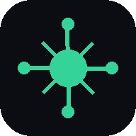

<div align="center">



# 数字果蝇 · Digital Drosophila

把一整套**果蝇全脑模拟实验**，做成能装进口袋的原生 Android 应用。

3D 活体围栏 · 2D 生态大世界 · 3D 养果蝇 —— 全部离线运行

<sub>Android 7.0+ · 完全离线 · 138,639 神经元本地运算</sub>

</div>

---

## 这是什么

「数字果蝇」由两个仓库组成：

| 仓库 | 内容 |
|---|---|
| **[digital-drosophila-web](https://github.com/Kalpa0448/digital-drosophila-web)** | 网页版实验本体：三页场景、神经仿真、行为模型、连接组数据 |
| **本仓库** | 原生 Android 封装：把网页版装进 APK，并重做整套移动端交互 |

也就是说，**这个 App 不是网页套壳**。页面里原本的顶栏、按钮、数据面板、参数滑块、观察记录、图例、曲线，全部被替换成原生 Android View；只有 3D/2D 渲染循环与每秒数千次更新的神经放电数据流留在 WebView 里。

连接组数据、脚本、样式全部内置在 APK，装完即用，无网络请求（检查更新除外，可关闭）。

## 三个页面

| 页面 | 内容 |
|---|---|
| **围栏** | 单只果蝇的 3D 活体观察。状态卡（饥饿 / 恐惧 / 疲劳 / 好奇）、投喂、粘板、单只观察、连接组实时放电条（感觉输入 / 中枢 / 运动输出三通道） |
| **大世界** | 2D 俯视生态。果蝇、蜘蛛、青蛙、捕蝇草、食物、果蝇卵、蜘蛛卵；种群统计、平均能量、最高代、被捕食；报警信息素、冒险觅食；种群曲线与平均能量曲线；加速 / 暂停 |
| **养果蝇** | 3D 培养皿种群。自主取食、粘板诱捕、报警信息素、惩罚性学习与记忆消退；脑活动可视化；气味场；视角切换 |

## 原生层做了什么

```
┌─────────────────────────────────────────┐
│ 原生 Android View                        │
│  顶栏 · 数据卡 · 工具条 · 参数面板        │
│  观察记录 · 单只观察 · 曲线 · 图例        │
│  底栏 · 启动页 · 关于页 · 更新面板        │
├─────────────────────────────────────────┤
│ WebView（仅渲染与高频数据）               │
│  three.js / Canvas 2D 场景               │
│  LIF 神经元仿真（Web Worker）            │
└─────────────────────────────────────────┘
```

原生层与网页层通过约 70 个 DOM 元素（id / class）通信：读数值刷新数据卡、写数值回传参数、轮询按钮 class 决定高亮状态。

## 特性

- **完全离线**：连接组数据内置 31 MB，除更新检查外无任何网络请求
- **本地运算**：138,639 神经元 / 15,091,983 连接边，1 ms 步长 LIF
- **原生控件**：参数滑块支持分组、复选框、索引定位；数据卡、观察面板、图例均为原生实现
- **状态高亮**：加速（显示当前倍速）、暂停、脑活动、气味场、种群曲线的按钮跟随真实运行状态高亮 / 熄灭
- **滑动指示器**：底栏高亮块在三个页面间平滑滑动
- **应用内更新**：关于页检查 GitHub Release，支持手动 / 自动检查、说明展示、下载并安装
- **零第三方依赖**：无第三方 Java 库，仅 Android SDK + 内置 three.js

## 安装

从 [Releases](https://github.com/Kalpa0448/digital-drosophila/releases) 下载最新的 `drosophila-*.apk`。

最低 Android 7.0（API 24），主要面向 arm64 设备。首次使用应用内更新需允许「安装未知应用」。

## 构建

需要 **JDK 17** + **Android SDK**（compileSdk 33）。

```bash
export JAVA_HOME=/path/to/jdk17
export ANDROID_HOME=/path/to/android-sdk
./gradlew :app:assembleDebug
```

Release 构建需要自备签名文件（未包含在本仓库中）：

```properties
# keystore.properties
storeFile=release.jks
storePassword=***
keyAlias=***
keyPassword=***
```

## 项目结构

```
app/src/main/java/io/github/kalpa0448/flybrain/
├── MainActivity.java   主壳：WebView 管理、底栏、抽屉、返回键
├── Hud.java            围栏页原生控件
├── PageHud.java        通用控件层（数据卡、横滑按钮、状态高亮）
├── ParamSheet.java     原生参数面板（三页通用）
├── InboxSheet.java     观察与审核面板（动态刷新）
├── ObsSheet.java       单只观察面板
├── ChartSheet.java     种群曲线
├── LegendCard.java     图例按钮与抽屉
├── InfoCard.java       养果蝇页引用信息
├── AboutSheet.java     关于页（含更新入口）
├── UpdateSheet.java    检查更新：说明渲染 / 下载 / 安装
├── UpdateChecker.java  GitHub Release 检查与 APK 下载
├── ApkProvider.java    ContentProvider，把 APK 交给系统安装器
└── ChoiceSheet.java    通用选项面板

app/src/main/assets/www/   来自网页版仓库的 play/（含连接组数据）
tools/adapt_web.py         维护工具（见下）
```

## 与网页版同步

网页版更新后，把新源码同步进本仓库：

```bash
python3 tools/adapt_web.py /path/to/digital-drosophila-web
```

脚本会：

1. 复制 `play/` → `app/src/main/assets/www`
2. 连接组数据改名为 `.gz.bin`（AAPT 会解包 `.gz` 并去后缀，导致 Worker 404）
3. 注入原生外壳样式（隐藏网页自带的 UI）
4. 检查原生层依赖的 DOM 契约（约 70 项），缺失时指出需要改哪个选择器

## 数据来源

- **连接组**：FlyWire FAFB v783（Dorkenwald et al., *Nature* 634:124–138, 2024）
- **全脑模型**：Shiu et al., *Nature* (2024) 全脑 LIF
- **降维脑**：FlyEM 雄性 CNS v1.0 —— 165,122 神经元 / 25,568,639 突触（Janelia / Cambridge / Google, 2026-09）

## 开源引用与致谢

三页实验、神经仿真与行为模型均由作者独立实现（见 [digital-drosophila-web](https://github.com/Kalpa0448/digital-drosophila-web)），**其中「养果蝇」场景**的神经群体模型、行为读出与参数体系参考了：

- [**fly-sim**](https://github.com/sjy20100819mc-cmyk/fly-sim) — 果蝇 3D 模拟器（MIT）
  把 16.5 万神经元降维成每只 48 个（25 功能群 / 145 条边，其中 119 条来自实测）

其他依赖与参考：

- **three.js** r147（MIT）
- **flybench** / Shiu et al. 2024 的反射判据

应用内同样内置了这些信息：关于页 →「开源引用与致谢」，以及养果蝇页右上角 **i** 按钮。

## 许可

本仓库代码以 **MIT** 发布，详见 [LICENSE](LICENSE)。

连接组数据版权归原作者所有，本项目**仅供学习与研究**，请勿用于商业用途。
